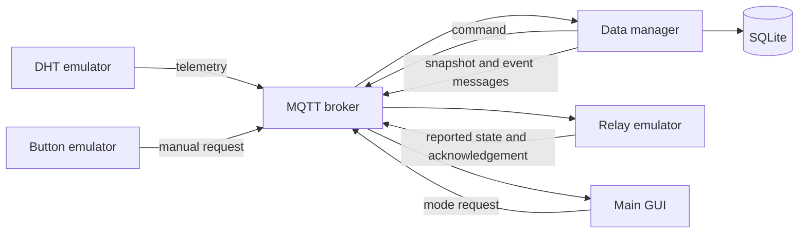

# SmartFan

**Daniel Kam · IoT Software Development in a Smart City Environment · 15 October 2026**

A working Python simulation of temperature and humidity monitoring in a public-building room. Three device emulators communicate with a separate data manager through a real local MQTT 3.1.1 broker. The application stores measurements, events and command outcomes in SQLite and displays a live PyQt5 dashboard.

## Run on this computer

Double-click **START.bat** in this directory. The project virtual environment is already installed. Close the main window to stop the services started by the launcher.

On another Windows computer, install **Python 3.12** including the Python launcher, run **SETUP.bat** once with internet access, and then **START.bat**. Python 3.12 is the tested version.

Cross-platform command-line setup (GUI appearance may differ):

```sh
python3.12 -m venv .venv
# Activate .venv using the command appropriate for your shell.
python -m pip install -r requirements.txt
python run.py
```

Runtime dependencies are pinned in `requirements.txt`. The launcher uses the aMQTT broker library, so Mosquitto is not required. The broker listens only on `127.0.0.1:18883`. No cloud account or physical hardware is needed. The local demo does not implement user authentication or TLS and is not intended for exposure to the internet.

## Demonstration

1. Wait for **MQTT + manager online** and the first reading.
2. Set temperature to 28 C. The fan turns ON after the relay confirms it.
3. Set 33 C. The environmental status becomes Alarm.
4. Set 27 C. The fan stays ON because of hysteresis.
5. Set 26 C and 50% humidity. The fan turns OFF.
6. Choose **Humid**. Humidity alone triggers the fan and Alarm.
7. Select **MANUAL**, then **Fan OFF**. Alarm remains visible.
8. Return to **AUTO**. The manager uses the fresh reading and turns the fan back ON.
9. Pause the sensor for more than ten seconds to demonstrate stale-data handling.
10. Resume it and choose **Normal** to recover.

To demonstrate an acknowledgement timeout, pause the relay while the fan is OFF, then choose Heat. After five seconds, a command Alarm appears. Resume the relay to reconcile its state. These actions affect only the simulation.

## Control rules

| Rule | Condition |
|---|---|
| Automatic ON | Temperature >= 28 C **or** humidity >= 70% |
| Automatic OFF | Temperature <= 26 C **and** humidity <= 65% |
| Between thresholds | Keep the previous target |
| Warning | Temperature >= 28 C or humidity >= 70%, below Alarm |
| Alarm | Temperature >= 32 C or humidity >= 80% |
| Sensor stale | More than 10 seconds without a valid reading |
| Command timeout | No matching relay acknowledgement within 5 seconds |

Thresholds are demonstration settings, not safety standards. Environmental severity and fan state are separate. For example, at 27 C and 50% humidity the status is Normal but a previously running fan stays ON until the OFF threshold is reached. Manual mode does not suppress alarms. A fan's real effect on room temperature or humidity is outside this software simulation.

## Architecture



The launcher starts broker and manager as separate processes. The GUI hosts three visible emulator panels; each device owns its own MQTT client. MQTT callbacks only enqueue messages. The manager thread is the only SQLite writer, and Qt widgets are updated by the Qt event loop.

## Source map

| File | Responsibility |
|---|---|
| `smartfan/core.py` | Pure control rules, hysteresis, modes, freshness and command tracking |
| `smartfan/mqtt_link.py` | Paho connection lifecycle, subscriptions and JSON inbox |
| `smartfan/emulators.py` | DHT, Button and Relay device implementations |
| `smartfan/manager.py` | Message processing, persistence, command publication and state snapshots |
| `smartfan/storage.py` | SQLite schema and queries |
| `smartfan/gui.py` | Main dashboard, emulator controls and CSV export |
| `smartfan/broker.py` | Loopback-only aMQTT broker |
| `run.py` | Service startup, monitoring and shutdown |
| `tests/test_core.py` | Unit and persistence tests |
| `tools/integration_check.py` | Full MQTT integration tests with an isolated database and port |
| `tools/record_demo.py` | Reproducible capture of the real application |

## MQTT contract

All topic names below start with `smartfan/room1/`. No topic is retained. Telemetry and most service messages use QoS 1. UI requests and snapshots use QoS 0. QoS 1 may redeliver a message, so measurement IDs are unique in the database and user requests are deduplicated. Relay commands specify an absolute state rather than a toggle. Requests and commands expire to prevent delayed actuation after a reconnect.

| Topic | Publisher | Subscriber | Content |
|---|---|---|---|
| `sensor/telemetry` | DHT | Manager | id, ts, device, temperature, humidity |
| `button/request` | Button | Manager | id, ts, state |
| `control/mode` | GUI | Manager | id, ts, mode |
| `relay/command` | Manager | Relay | id, ts, expires_at, state, source |
| `relay/state` | Relay | Manager | id, ts, state, command_id |
| `events` | Manager | Optional monitoring clients | ts, level, kind, text |
| `manager/state` | Manager | GUI | current state, recent readings, events and database counts |

Example telemetry (timestamps are Unix seconds):

```json
{"id":"example-reading-id","ts":1791828000.0,"device":"dht-1","temperature":28.0,"humidity":50.0}
```

The example timestamp is illustrative. Live messages must contain the current time. Readings older than ten seconds or more than two seconds in the future are rejected. Telemetry accepts finite numeric temperatures from -20 to 60 C and humidity from 0 to 100%. Booleans and malformed payloads are rejected.

## Storage and failure handling

The default database is `data/smartfan.sqlite3`, created on first run. Tables are `measurements`, `events` and `commands`. Measurements carry both producer and receiver times. Commands store pending, acknowledged, timeout, interrupted or send_failed outcomes. The GUI receives the most recent 120 readings and 80 events; older records remain in SQLite. CSV export contains the recent readings currently displayed.

On manager restart, old measurements remain history and are not treated as live state. Pending commands are marked interrupted. Broker reconnection renews subscriptions and requires fresh device reports. A stale sensor suspends automatic decisions and preserves the target. Missing relay acknowledgement does not turn the requested state into a confirmed state. The GUI disables commands when the manager snapshot is stale. Database errors are surfaced rather than reported as successful writes.

## Tests

```sh
python -m pip install -r requirements-dev.txt
python -m pytest -q
python tools/integration_check.py
```

The integration test creates its own port and database under `build/`, and stops only the services it starts. It tests real broker traffic, relay acknowledgement, hysteresis, humidity-only activation, manual operation, malformed data, stale sensors, relay recovery, persistence and broker reconnection. See `docs/test_results.json` and `submission/Test_Report.md` for the recorded results.

For individual processes, run `python -m smartfan.broker`, `python -m smartfan.manager`, and `python -m smartfan.gui` in three terminals. Alternatively use `python run.py --external-broker` with an already running compatible broker. `SMARTFAN_HOST`, `SMARTFAN_PORT`, `SMARTFAN_PREFIX` and `SMARTFAN_DB` are optional environment overrides. The bundled broker always binds to loopback.

## Submission files

Final deliverables are in `submission/`: the presentation, project summary in DOCX/PDF, demonstration video, speaker script and submission checklist. Keep the video beside the PowerPoint file when copying the folder.

The 10–12 minute personal presentation recording and a GitHub repository URL must be added before submission. The short automated screen capture is not a substitute for Daniel's presentation recording. Use the link update tool documented in the submission checklist after those URLs are available.

## References

- Course assignment and supplied examples, including [SmartHome](https://github.com/yuryyu/SmartHome). Used to understand the assignment structure; application source was implemented for this project.
- [Eclipse Paho Python API](https://eclipse.dev/paho/files/paho.mqtt.python/html/client.html)
- [aMQTT broker API](https://amqtt.readthedocs.io/en/latest/references/broker/)
- [Python sqlite3 documentation](https://docs.python.org/3/library/sqlite3.html)
- [PyQt5 documentation](https://www.riverbankcomputing.com/static/Docs/PyQt5/)
